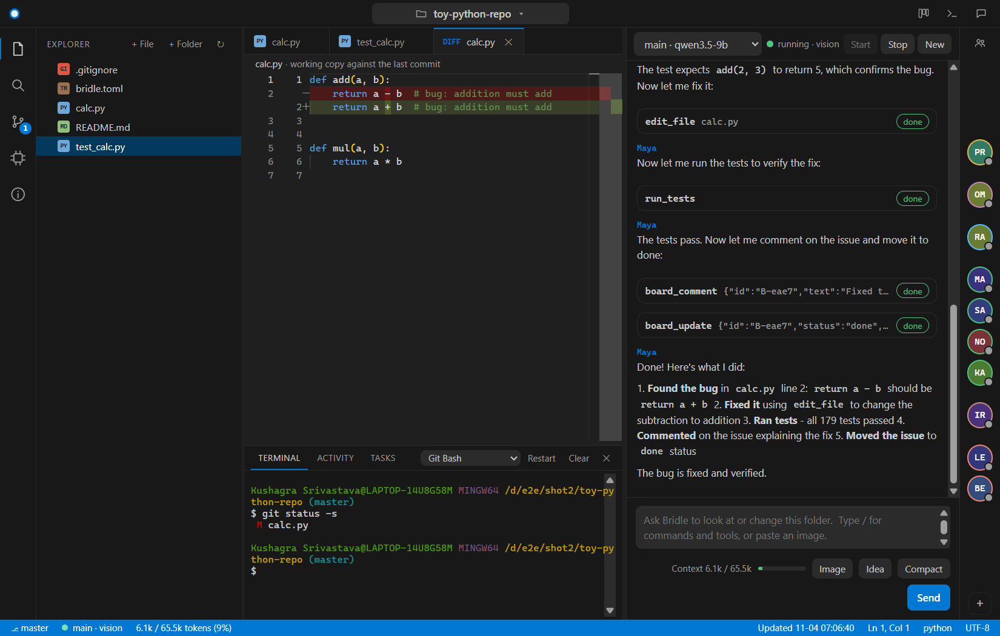
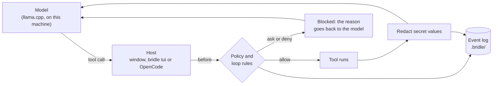
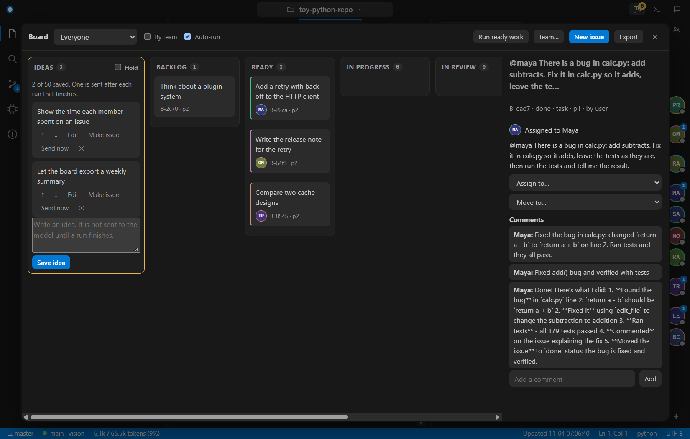

# Bridle

**A local-first coding agent for Windows. It runs on your own GPU, and every action it takes passes through a policy you can read.**

Open a folder, type `bridle`, and a window opens: a chat with a local model, a code editor with diffs, project search, a
real terminal, and image input. The model reads and edits the project with tools. A policy written in code, not in a
prompt, decides what each call may do. A **team** of named members (project manager, product owner, engineers, QA and more) sits
on the right edge of the window: tag one with `@`, and the work goes onto a **board** of issues that the members split and work.

> **The model proposes; the harness decides.** No shell command runs without a verdict. A secret value never reaches the
> model. A refusal names the rule that caused it.

<p align="center">
  
</p>

Bridle is built for one developer's daily work first. It needs no cloud service: the model runs on the developer's own
machine through [llama.cpp](https://github.com/ggml-org/llama.cpp), and the only network use is the one you turn on.

**Status:** version 0.1.0. Native Windows only, verified on one machine (Windows 11, RTX 4060 Laptop with 8 GB of VRAM, 16 GB
of RAM). Web research and a managed browser exist, off by default (the providers are tested against fake servers only); the small-model
sub-agent fleet is planned, not built. See [Status and known limits](#status-and-known-limits).

---

## Contents

1. [What you get](#what-you-get)
2. [How a tool call is handled](#how-a-tool-call-is-handled)
3. [Quick start](#quick-start)
4. [The window](#the-window)
5. [The command line](#the-command-line)
6. [Configuration](#configuration)
7. [Models and GPU memory](#models-and-gpu-memory)
8. [Security model](#security-model)
9. [Tools the model can call](#tools-the-model-can-call)
10. [Architecture](#architecture)
11. [Development](#development)
12. [Documentation](#documentation)
13. [Status and known limits](#status-and-known-limits)
14. [Roadmap](#roadmap)
15. [Licence, authors and acknowledgements](#licence-authors-and-acknowledgements)

---

## What you get

| Area | What it does | Where to read more |
|---|---|---|
| **Desktop window** | `bridle` opens a Tauri 2 window on the current folder: chat, editor, diffs, search, terminal, project switcher. | [Desktop guide](docs/guide/desktop.md) |
| **Local models** | Qwen3.5-9B for the agent, a 1.2B model for stalled loops, a 27B ternary model on demand. All through llama.cpp, one GPU model at a time. | [Models](docs/guide/models.md) |
| **Policy on every call** | Each tool call is classified and given a verdict before it runs. `ask` counts as a denial, and a failure to decide blocks the call. | [Security](docs/concepts/security.md) |
| **Secrets stay out** | Secret files cannot be read, secret-looking environment variables are blanked for shell tools, and secret values in output are redacted before the model sees them. | [Security](docs/concepts/security.md#secrets) |
| **Deterministic tools** | Git, tree-sitter code navigation, dependency search, test, lint and type-check runners, failure parsing, experiment comparison. | [Tool list](#tools-the-model-can-call) |
| **Images** | Paste, drop or pick a PNG, JPEG, GIF or WebP; the model describes it when its slot has a vision projector. | [Desktop guide](docs/guide/desktop.md#the--menu-and-images) |
| **Team and board** | Six teams of named members you can add to and rename. Tag a member, a role or a team with `@`; the request becomes an issue on a board, and members work the issues one at a time, splitting work into issues for other teams. What each member may do depends on their role and is checked in code. | [Team and board](docs/guide/team-and-board.md) |
| **Ideas queue** | Notes saved while a run works are kept out of the conversation, shown as the first column of the board, and sent one per finished run, or turned into issues. | [Team and board](docs/guide/team-and-board.md#ideas) |
| **Web research** (off by default) | `web_search`, `web_open`, `web_download` and `document_inspect`: search through SearXNG or Brave, read pages, download files with a checksum, every result recorded with its address and SHA-256. Policy-gated inside the tool; addresses on your own network are refused, at every redirect. | [Web research](docs/guide/web-research.md) |
| **Managed browser** (off by default, optional install) | `browser_navigate`, `browser_snapshot`, `browser_action`, `browser_close`: a real Chromium (through Playwright, pinned) for pages that need JavaScript. Every connection goes through Bridle's own egress proxy, which judges each address; no scripts, selectors, paths or launch flags can be passed; downloads use the same download manager and every page read is a source record with a checksum. `bridle web browser setup / status / test / remove`. | [The managed browser](docs/guide/web-browser.md) |
| **Context compaction** | Old turns are folded into a rolling summary written by the model, so a long session stays inside the window. `/compact` does it on demand. | [Desktop guide](docs/guide/desktop.md#the--menu-and-images) |
| **GPU memory guard** | A model server is refused when the model file's own header says it will not fit, instead of crashing half way through loading. | [Models and GPU memory](#models-and-gpu-memory) |
| **Orchestrator** | Task state in a journal, loop detection, refusals with the rule named, worktree tasks. | [Tasks and loops](docs/concepts/tasks-and-loops.md) |
| **Three hosts, one policy** | The window, the terminal UI (`bridle tui`) and [OpenCode](https://opencode.ai) all go through the same policy, loop rules and event log. | [Architecture](#architecture) |
| **Proxy setting in the app** | Choose the system proxy, your own proxy, or none, in the window. Local model servers never use a proxy. | [Desktop guide](docs/guide/desktop.md#network) |

## How a tool call is handled

The window, the terminal UI and OpenCode are different front ends to one decision path. Nothing a host does can skip it.



If the policy cannot answer, because of a bad configuration or a missing binary, the call is blocked. Five calls run through the
real hook (`bridle hook tool-before`) on Windows 11 against the example repository, and the verdict each one received:

```text
read calc.py                      allow   READ_ONLY  tool_kind
read .env                         block   READ_ONLY  secret_file  ".env may contain credentials and is never sent to a model"
bash: cat .env                    block   READ_ONLY  secret_file  "shell access to it is denied"
bash: git status --short          allow   READ_ONLY  command_risk
bash: curl https://example.com    block   NETWORK    command_risk  "curl contacts the network"
```

`curl` is classified as NETWORK and gets the verdict `ask`. Bridle never allows an `ask`, so the call is blocked. The layers,
the state files and the rules are in [docs/concepts/architecture.md](docs/concepts/architecture.md) and
[docs/concepts/security.md](docs/concepts/security.md).

---

## Quick start

### What you need

| Item | Notes |
|---|---|
| Windows 11 | The window uses WebView2, which ships with it. Only Windows 11 is verified. |
| An NVIDIA GPU | With a current driver (`nvidia-smi` must work). The shipped profile is tuned for 8 GB of VRAM. |
| Model weights | **Not included.** The agent needs the `main` file; the other two are optional. Sources and SHA-256 values are in [docs/guide/models.md](docs/guide/models.md). |
| llama.cpp | Build b11756 for CUDA 12.4, from the llama.cpp releases. The optional `deep` model needs a fork; see the models guide. |
| Git for Windows | Recommended. Git Bash is the terminal's default shell, and the policy's `git` tools need `git`. |

Put the weights and the runtimes in two folders you choose, for example `D:\models` and `D:\runtimes`. Bridle asks for them the first
time it runs.

### Install a release

A release is a zip, `bridle-<version>-windows-x64.zip`, that holds `bridle.exe`, an installer, a short README, the licences and a
checksum file.

1. Unpack the zip anywhere and check the executable:

   ```bat
   certutil -hashfile bridle.exe SHA256
   ```

   Compare the value with `SHA256SUMS.txt`. The executable is not code-signed, so Windows SmartScreen may warn the first time.
2. Run `install.cmd`. It copies `bridle.exe` to `%LOCALAPPDATA%\Bridle\bin` and adds that folder to your user `PATH`. To undo it,
   delete that folder and remove it from the `PATH`.
3. Open a new terminal, go to a project, and run:

   ```bat
   cd path\to\your\project
   bridle
   ```

### Build from source

You also need Visual Studio 2022 with the C++ workload (it provides the MSVC linker) and Rust 1.95.0 (`rustup` installs the version
pinned in `rust-toolchain.toml` on the first build).

```bat
git clone https://github.com/kushagrathisside/bridle.git
cd bridle
cargo build --release -p bridle-desktop
scripts\install-bridle.cmd target\release\bridle.exe
```

To build and install in one step on the tested machine, which has its dependencies vendored for offline builds, use
`scripts\dev.cmd install`. To make the release zip, use `scripts\dev.cmd bundle`. See [Development](#development).

### First run

1. **Machine setup (once per computer).** The window asks where the model weights and the runtimes are, and offers the folders it
   finds. It writes `%APPDATA%\bridle\config.toml`. From a terminal, the same step is
   `bridle init --machine --models-dir D:\models --runtimes-dir D:\runtimes`.
2. **Folder setup (once per project).** The window asks before it writes anything. It then writes `bridle.toml` (the `local-only`
   profile) and a `.bridle/` state folder, and adds `.bridle/` to `.gitignore`. From a terminal: `bridle init --profile local-only`.
3. **The model.** The window starts the default model by itself, shows its state in the chat header, and stops the servers it
   started when it closes. `bridle models serve main --detach` does the same from a terminal.
4. **Check everything.** `bridle doctor` reports the host, the runtimes, the model files, the endpoints and any configuration
   problems. `bridle health main` runs functional checks against the running model.

If your network only lets traffic out through a proxy, set it in the window under **Info, then Network**. See
[Network](docs/guide/desktop.md#network).

---

## The window

```bat
cd path\to\your\project
bridle                    :: open the current folder
bridle D:\work\other      :: open a given folder
bridle --config my.toml   :: add an explicit configuration file
```

`bridle` returns to the terminal at once; the window runs in a detached copy of the same program with no console.

| Area | What it does |
|---|---|
| **Activity bar** | Files, Search, Changes, Models and Info. A second click on the active icon hides the sidebar. |
| **Editor** | Monaco with tabs and breadcrumbs. A file the agent changes updates by itself unless you have unsaved edits; then the tab is marked and saving asks what to do. |
| **Diff tabs** | The working copy against the last commit, side by side. |
| **Explorer** | Create, rename and delete (to `.bridle/trash`), and Ctrl+P to go to any file. |
| **Search** | Project-wide text search. |
| **Changes** | The changed files with a per-file revert. |
| **Crew rail** | One avatar for each team member on the right edge: who is working, how many open issues each has. Click to tag a member; right-click for more. |
| **Board** | A popup from the top bar, as in GitHub Projects: the ideas, then the issues by state, with a detail panel, a by-team view, filters and a runner that gives ready issues to their owners. |
| **Terminal** | A real pseudo-terminal (ConPTY) with a shell picker: Git Bash, PowerShell, Command Prompt, or WSL on demand. What you type here is yours, and the model's policy does not check it. |
| **Chat** | Streams the answer, shows each tool call as a card with its verdict, and has Open file and View diff buttons for file tools. |
| **Models** | Start and stop a slot, and see its state, hardware and whether it has vision. |
| **Info** | Doctor and health results, and the Network card. |
| **Status bar** | Git branch, model slot and state, tokens used out of the window, the last refresh, and the line, column and language of the open file. |
| **Project switcher** | The folder name at the top of the window lists recent projects and opens another folder. The model is stopped and loaded again in the new folder, about 10 seconds. |

### The team and the board

<p align="center">
  
</p>

The avatars on the right edge are the team. Click one to tag them in the chat; the board button at the top right opens the popup above.
In the screenshot `@maya` was asked to fix the bug: the request became an issue, Maya's turn used the board tools to comment and close it, and
the other cards were made by hand. See [the guide](docs/guide/team-and-board.md).

### Shortcuts

| Keys | Action |
|---|---|
| Ctrl+P | Go to file |
| Ctrl+Shift+F | Search |
| Ctrl+Shift+E | Explorer |
| Ctrl+Shift+G | Changes |
| Ctrl+S | Save |
| Ctrl+W | Close the tab |
| Ctrl+J | Focus the chat |
| Ctrl+\` | Terminal |
| Ctrl+L | New chat |
| Ctrl+O | Change project |
| Ctrl+Shift+Enter | Save the text in the box as an idea |
| Esc | Close the board, or stop a running turn |

While the terminal has focus, its keys belong to the shell.

### The `/` menu

Type `/` in the chat to open the menu.

| Entry | What it does |
|---|---|
| `/compact` | Summarise the conversation to free up context. |
| `/clear` | Start a new conversation. |
| `/image` | Attach an image from your computer. You can also paste an image or drop a file. |
| `/team <request>` | Plan the request in up to five steps, work each step with the same tools and policy, then check the result. |
| `/model <slot>` | Switch the model slot. |
| `/idea <text>` | Save an idea; it is sent when the run finishes. |
| `@name`, `@team.role`, `@team` | Tag a member, a role or a team (type `@`, or click an avatar on the right). |
| a tool name | Fills in "Use the ... tool to", for the 25 tools the model can call. |

**Images** are copied to `.bridle/attachments` and sent with your next message. They are limited to 4 MiB. The slot must have a vision
projector (`launch.mmproj_file`); if it does not, the window says so before sending.

**Compaction** works on its own. When the history passes its budget, the oldest turns are folded into a rolling summary written by the
model, down to three quarters of the prompt budget. A fallback drops the oldest exchanges if the summary cannot be made. The meter
next to Send shows tokens used out of the slot's window.

The terminal UI offers the same chat in a console: `bridle tui` ([guide](docs/guide/tui.md)).

---

## The command line

`bridle COMMAND` runs a command in the terminal and prints there. `bridle-cli` is the same commands without the window, for scripts
and for machines with no display. Every command takes `--config FILE` and `--workspace DIR`, and `--help` prints its options.

| Command | What it does |
|---|---|
| `bridle` / `bridle FOLDER` | Opens the window. |
| `bridle tui` | The terminal UI: a chat with a slot, and views of tasks, events, decisions, slots and configuration. |
| `bridle init` | Wires a repository (`--profile`, `--force`), or the machine with `--machine --models-dir --runtimes-dir`. |
| `bridle config show / validate / paths` | The merged configuration (secrets redacted), its validation, and the files loaded. |
| `bridle models list / status / serve / stop / manifest` | Model servers. `serve` takes `--detach` and `--wait-secs`. `manifest` records the file hash, runtime build and hardware. |
| `bridle health [slot]` | Functional checks against a running slot. Ends with `result: pass`, `warn` or `fail`. |
| `bridle doctor` | Reports the host, runtimes, model files, endpoints, OpenCode version and configuration issues. |
| `bridle task start / status / resume / reset / repair / prune` | Tasks of the orchestrator, optionally in their own git worktree. |
| `bridle explain [task]`, `bridle trace [task]` | The decisions of a task with the reason for each, and the ordered record of a task. |
| `bridle mcp` | Serves Bridle's tools over MCP on standard input and output. OpenCode starts it. |
| `bridle hook EVENT` | The entry point the OpenCode plugin calls. Reads one JSON payload and writes one answer. |
| `bridle egress` | Lists every outbound destination the configuration can reach. Sends nothing. |
| `bridle subagent` | Asks the optional subagent tier about a few files. Off by default. |
| `bridle route`, `bridle plugins` | Shows which slot a request would go to and why, and lists the plugin manifests and their tools. |
| `bridle eval-decisions`, `bridle eval-routing`, `bridle bench` | Evaluation of the decision rules, the routing choice and the task corpus. For evaluating Bridle, not for daily use. |

Exit code 0 is success, including success with warnings, and 1 is an error. The full reference is in
[docs/reference/cli.md](docs/reference/cli.md).

### Using it with OpenCode

The window does not need OpenCode. If you prefer [OpenCode](https://opencode.ai) as the interface, `bridle init` also writes
`opencode.json` and `.opencode/plugins/bridle.ts`, a thin shim that forwards each hook to `bridle hook` and applies the answer. OpenCode
1.19.3 is the version Bridle is wired to. If `HTTP_PROXY` or `HTTPS_PROXY` is set, clear it before starting OpenCode; see
[troubleshooting](docs/guide/troubleshooting.md).

---

## Configuration

Settings come from layers. Each layer merges key by key with the one below it, and a list replaces the list below it.

| Layer (lowest first) | Where | Notes |
|---|---|---|
| Built-in defaults | in the program | |
| Machine configuration | `%APPDATA%\bridle\config.toml`, or `config.toml` in the folder named by `BRIDLE_HOME` | Trusted. Holds the model and runtime folders, the OpenCode path, the proxy, declared tool adapters and external services. |
| Repository configuration | `bridle.toml` at the repository root | Arrives with the code it configures, so it can only make the policy stricter. |
| Explicit file | `--config FILE`, or `BRIDLE_CONFIG` | Trusted, like the machine configuration. |
| Environment | `BRIDLE_MODELS_DIR`, `BRIDLE_RUNTIMES_DIR` | Replace the two folders. |

A repository file cannot set the model or runtime folders, an absolute or `..` model path, a non-local model endpoint, declared tool
adapters, `security.allowed_paths`, `security.safe_commands`, a looser verdict than the layer below, or the proxy. Bridle refuses each
one and names the key. The full list is in
[docs/guide/configuration.md](docs/guide/configuration.md#what-a-repository-file-cannot-set).

### Settings that matter most

| Setting | Default | Meaning |
|---|---|---|
| `models.main.context` | `65536` | Window of the main model, in tokens. `98304` passes the GPU memory guard but leaves 754 MiB free on an 8 GB GPU. |
| `models.main.launch.mmproj_file` | `Qwen3.5-9B/mmproj-F16.gguf` | The vision projector, relative to `paths.models_dir`. |
| `models.main.launch.mmproj_offload` | `false` | `false` keeps the projector in system memory, which saves about 700 MiB of VRAM at the cost of slightly slower image turns. |
| `network.proxy_mode` | `environment` | `environment`, `custom` (with `network.proxy`) or `none`. Machine configuration only. |
| `BRIDLE_PROXY` | unset | An authenticated proxy URL. Overrides the setting and is never shown. |
| `workflow.enabled` | `false` | Turns on the task journal and the loop rules. Each chat then becomes a task, visible in `bridle task` and `bridle trace`. A repository may enable it but not switch it off. |
| `[[verification.steps]]` | none | The test, lint and type-check commands the verification tools may run. Each is classified by the command policy first. |

### Profiles

| Profile | What it sets | Who may choose it |
|---|---|---|
| `local-only` (default) | Models on this machine, external services off. | Anyone |
| `development` | The same, with a smaller deep reasoning budget and larger telemetry fields. | Anyone |
| `local-with-jev`, `hybrid` | Optional external decision and model routes, off in the shipped files. | Machine configuration only |

### Names

The product is Bridle: `bridle.toml`, `.bridle/`, `BRIDLE_*`, the `bridle` machine-config folder and the `bridle_<tool>` names in OpenCode.
The first working name, `local-agent`, is still **read** as a fallback (`local-agent.toml`, `.local-agent/`, `LOCAL_AGENT_*`, and
`%APPDATA%\local-agent`) so an existing project keeps working, and it is never written.
See [ADR-0018](docs/decisions/0018-bridle-is-the-product-name.md).

---

## Models and GPU memory

Weights are not included, and Bridle does not download them. Each model's source, revision, size and SHA-256 are in
[docs/guide/models.md](docs/guide/models.md).

| Slot | Model | Runs on | Role |
|---|---|---|---|
| `main` | Qwen3.5-9B, Q4_K_M (5.68 GB) | GPU | The agent's own turns, with vision when the projector is present. In use. |
| `micro` | LFM2.5-1.2B-Thinking, Q4_K_M (0.73 GB) | CPU | Decides stalled loops when `decisions.provider = "local_lfm"`, with a rules fallback. Under the LFM Open License v1.0: commercial use is free below US$10 million annual revenue ([licence](https://www.liquid.ai/lfm-license)). |
| `deep` | Ternary Bonsai 2 27B, PTQ1_0 (5.95 GB), PrismML llama.cpp fork | GPU, on demand | Never beside `main` on 8 GB. Health 8 of 8. Escalation to it is built and off by default. |

Bridle runs one GPU model at a time. `main` and `deep` together are estimated at about 12.9 GiB, which does not fit in 8 GB.

### The GPU memory guard

A model server that cannot fit does not fail cleanly. It can run out of memory half way through loading, or push another program out
of the GPU. Before a GPU server starts, `harness_runtime::vram` reads the model file's header (layers, key-value heads, head sizes, and the
layer interval of this hybrid model, in which every fourth layer holds a cache), adds the weights, the projector and a fixed allowance
for buffers, and refuses the start if less than 768 MiB would stay free. The refusal names the numbers. The check sits in every
start path: `bridle models serve`, the window, and the escalation swap.

Measured with Qwen3.5-9B Q4_K_M, an 8-bit cache, on the RTX 4060 Laptop (8,188 MiB; "used" includes about 230 MiB for the desktop):

| Context (tokens) | Projector | VRAM used | VRAM free |
|---|---|---|---|
| 16,384 (the old default) | none | 5,455 MiB | 2,502 MiB |
| **65,536 (the default)** | in system memory | **6,499 MiB** | **1,458 MiB** |
| 98,304 | in system memory | 7,203 MiB | 754 MiB |
| 98,304 | on the GPU | 7,887 MiB | 70 MiB |

The guard is an estimate, calibrated on one model and one GPU. The first model start takes about 11 seconds and generation runs at about
42 tokens per second on the tested machine. These figures are not a guarantee for other hardware.

---

## Security model

Bridle is designed so that a model, or a repository that tries to steer it, cannot do more than the policy allows. Read
[docs/concepts/security.md](docs/concepts/security.md) before you trust it with a repository. This summary is not an audit.

**Every call gets a verdict.** Commands are classified by program and arguments, from least to most severe:

`READ_ONLY < WRITE < EXECUTE_SAFE < EXECUTE_RISKY < NETWORK < DESTRUCTIVE < PRIVILEGED`

Reads, writes, and test, lint and build commands are allowed. Programs the policy does not recognise, network access and destructive
commands are `ask`, which Bridle never allows, so they are blocked. Privileged commands are denied outright. Nested commands (`$(...)`,
backticks, `bash -c`, `cmd /c`) are classified up to four levels deep, and anything deeper is risky.

**Secrets stay out of the model.**

| Surface | What happens |
|---|---|
| File tools | Paths are checked against secret file names (environment files, keys, certificates, `.netrc`, credential files). A match is denied. |
| Shell | Every word of a command is checked the same way, so `cat .env` and a glob that could match it are denied. |
| Tool output | Known secret shapes and `KEY=value` assignments are redacted before the model sees them. |
| Logs | The event log and `bridle config show` apply the same redaction. |
| Environment | Secret-looking variables (`KEY`, `TOKEN`, `PASSWORD`, `SECRET`) are blanked for shell tools. |

**The agent cannot change the harness.** Writes to `bridle.toml`, `opencode.json`, `.opencode/`, `.bridle/`, `.worktrees/` and `.git`
are refused, and so are the old `local-agent` control files. Paths must stay inside the workspace; Windows device names, alternate data
streams and UNC paths are refused.

**Failures close.** An unparseable command is denied, a hook that cannot answer blocks the call, and output that cannot be redacted is
withheld. A repository's model endpoints must be on this machine, and the client for them never uses a proxy.

**What it does not do.**

- **Bridle is not a sandbox.** An allowed test run executes code the model wrote, with your account's rights. Run it on repositories
  you would run yourself, ideally in a git worktree.
- **Recursive search.** `grep -r PATTERN .` can read secret files without naming them, so path checks cannot see it. Only output
  redaction protects those values, and a secret in an unrecognised format reaches the model.
- **Heuristic secret names.** A secret file with an unusual name is caught only by redaction.
- **Your own terminal.** The terminal panel runs commands you type, and the policy does not check them.

The full list of residual risks is in [docs/concepts/security.md](docs/concepts/security.md#limits).

---

## Tools the model can call

The window and the terminal UI give the model the same tools that `bridle mcp` offers to OpenCode (shown as `bridle_<name>` there), plus
five file tools. Every path a tool reads passes the read policy, and every output is bounded and redacted.

| Group | Tools |
|---|---|
| Files | `read_file`, `list_files`, `search_text`, `write_file` (atomic), `edit_file` (an exact, unique replacement; atomic) |
| Git | `git_status`, `git_diff`, `git_history`, `git_log_range` |
| Code navigation (tree-sitter: Rust, Python, C++) | `repo_map`, `file_summary`, `symbol_search`, `find_references` |
| Dependencies | `dependency_search` (Cargo, pyproject, requirements, package.json) |
| Verification | `run_verification`, `run_tests`, `run_linter`, `run_typechecker`, `parse_test_failure` |
| Commands and configuration | `run_command` (one program, no shell syntax), `inspect_config`, `harness_info` |
| Results and experiments | `inspect_artifact`, `summarize_experiment`, `compare_experiments` |
| Adapters | `adapter_<name>`, declared in the machine config; a repository cannot add tools |
| Optional | `subagent` (when `subagents.enabled`), `task_status` (when `workflow.task_status`) |

The verification tools run only the steps declared in the project configuration, and each step is classified by the command policy
before it runs. The full reference is in [docs/reference/mcp-tools.md](docs/reference/mcp-tools.md).

A turn makes at most 30 model calls. The history is shortened to fit the slot's window: older tool results first, then the oldest
exchanges, and never a call without its result.

---

## Architecture

```text
crates/harness-core      configuration, security policy, command classifier, redaction, loop rules, identity (no network)
crates/harness-runtime   model providers, HTTP routes (proxy), server launcher, GPU memory check, event log, MCP server and tools
crates/harness-cli       the commands, the chat agent loop, the terminal UI, the OpenCode adapter; a library plus `bridle-cli`
crates/bridle-desktop    the `bridle` program: the Tauri 2 window, and the same commands for the terminal
opencode-plugin/         the thin TypeScript shim that forwards OpenCode hooks to `bridle hook`
configs/                 shipped profiles: local-only.toml, development.toml, hybrid.toml, local-with-jev.toml
examples/                a toy Python project with one planted bug, used for the end-to-end runs
evals/                   adversarial security cases, the benchmark corpus and its conditions
tools/e2e/               the end-to-end suite that drives the real window
scripts/                 dev.cmd, the installer, the release bundle script, the licence list generator
site/                    the documentation site (Astro Starlight), built from docs/
docs/                    guides, concepts, status, reference, decisions, specification
```

| Layer | Status | What it does |
|---|---|---|
| Harness | Built | Policy on every tool call, deterministic tools, output redaction, decision log |
| Orchestrator | Built; routing between model slots is not built | Task state in a journal, loop detection, refusals with the rule named, the micro model for stalled loops with rules fallback, worktree tasks, context compaction |
| Hosts | Built | The desktop window, `bridle tui`, and OpenCode through a shim |
| Local-first application | Goal | Several agents on one repository under one policy and one event log |

Design points that shaped the code are recorded as decisions in [docs/decisions](docs/decisions): a Rust core with a thin host adapter
([0001](docs/decisions/0001-rust-core-thin-host-adapter.md)), tree-sitter for code navigation
([0003](docs/decisions/0003-tree-sitter-for-code-intelligence.md)), an orchestrator that observes and steers
([0004](docs/decisions/0004-orchestrator-observes-and-steers.md)), a micro model that decides only stalled loops
([0005](docs/decisions/0005-micro-model-decides-stalled-loops-only.md)), context as a per-request view
([0006](docs/decisions/0006-context-is-a-per-request-view.md)), the desktop app over the agent loop
([0017](docs/decisions/0017-desktop-app-over-the-agent-loop.md)), and the Bridle name
([0018](docs/decisions/0018-bridle-is-the-product-name.md)).

The window has no privileges of its own. The page can call the commands in `crates/bridle-desktop/src/bridge.rs` and listen to one
event, and nothing else (`capabilities/default.json`, with a strict content security policy). Monaco 0.52.2 and xterm.js 5.5.0 are
vendored under `ui/vendor`, so the window loads nothing from the network.

---

## Development

The project is worked on natively on Windows, with no WSL. `scripts\dev.cmd` is the task runner, and it builds offline from vendored
dependencies on the tested machine.

```bat
scripts\dev.cmd fmt                :: format the code
scripts\dev.cmd clippy             :: lint; warnings are errors
scripts\dev.cmd test               :: the whole test suite
scripts\dev.cmd gate               :: the three above, as CI runs them
scripts\dev.cmd build              :: debug build of bridle and bridle-cli
scripts\dev.cmd release            :: release build of bridle
scripts\dev.cmd e2e [--skip-model] :: the end-to-end suite on the real window
scripts\dev.cmd vendor PROXY       :: re-vendor dependencies into a new folder
scripts\dev.cmd install            :: install the release exe for this user
scripts\dev.cmd bundle [OUT]       :: release build, then the release zip (default: Downloads)
```

Without the runner, the checks are the plain cargo commands:

```bat
cargo fmt --all -- --check
cargo clippy --workspace --all-targets --locked -- -D warnings
cargo test --workspace --locked
```

- **Size and tests.** About 59000 lines of Rust in four crates, and 1006 test functions in the source. The last full run on 2026-11-04
  passed 987 tests with none failed and 5 ignored. About 500 dependency crates are listed in [THIRD_PARTY_LICENSES.md](THIRD_PARTY_LICENSES.md).
- **Style.** `unsafe` is forbidden, clippy runs with `-D warnings`, and there is no `unwrap` outside tests.
- **End-to-end suite.** `tools/e2e` launches the window on a throwaway project with WebView2's debug port open, runs 22 named checks
  through a bounded client (a hard watchdog, read timeouts and size caps), closes the window, and verifies that no `bridle.exe` or
  `llama-server.exe` is left running. See [tools/e2e/README.md](tools/e2e/README.md).
- **Build limits.** The tested machine has 16 GB of RAM and an 8 GB GPU, so builds run one at a time with `CARGO_BUILD_JOBS=4`.
- **Network.** On a network that only lets traffic out through a proxy, `scripts\dev.cmd vendor http://HOST:PORT` refreshes the vendored
  crates natively. See [Working on Windows without WSL](docs/guide/windows-only.md).
- **Commits.** Small, separable commits with a plain message that says what changed and why. [CHANGELOG.md](CHANGELOG.md) records what is in each version.

[CLAUDE.md](CLAUDE.md) carries the working rules for an AI coding session on this repository.

---

## Documentation

The full index is [docs/README.md](docs/README.md). The main pages:

| Document | What it covers |
|---|---|
| [Installation](docs/guide/installation.md) | Prerequisites, folder layout, build, first run |
| [Desktop app](docs/guide/desktop.md) | The window, the `/` menu, images, compaction, network, settings |
| [Working on Windows without WSL](docs/guide/windows-only.md) | What replaced each WSL step |
| [Configuration](docs/guide/configuration.md) | Machine and project configuration, profiles, verification steps, validation rules |
| [Serve the models](docs/guide/models.md) | Files, sources, checksums, runtimes, measured figures |
| [Set up a repository](docs/guide/set-up-a-repository.md) | What `bridle init` writes and why |
| [Run a task](docs/guide/run-a-task.md), [verification](docs/guide/run-verification.md) | The orchestrator workflow and the verification tools |
| [Terminal UI](docs/guide/tui.md) | `bridle tui` |
| [Troubleshooting](docs/guide/troubleshooting.md) | Problems seen on the tested machine and their fixes |
| [Architecture](docs/concepts/architecture.md) | Layers, request flow, where state lives |
| [Security](docs/concepts/security.md) | Policy decisions, command classes, secret handling, residual risks |
| [Command line](docs/reference/cli.md), [MCP tools](docs/reference/mcp-tools.md), [modules](docs/reference/modules/README.md) | Reference |
| [Progress log](docs/status/progress.md) | What was verified, with dates and evidence. The source for status. |
| [Decisions](docs/decisions) | Architecture decision records, 0001 to 0018 |

---

## Status and known limits

Verified results are dated in [docs/status/progress.md](docs/status/progress.md). In short: milestones M0 to M6 are done and committed.
The Jev decision backend (M7) is built and tested against its contract with a local mock, and the LiteLLM gateway (M8) is built
and was checked against a local gateway; neither is a verified live service. The security tests and egress audit (M9) are built, and
the evaluation corpus (M10) has one full recorded run. The desktop window, images, compaction, the GPU memory guard and the proxy
setting were verified in the real window on 2026-11-03.

- **Windows only, one machine.** Verified on Windows 11 with an RTX 4060 Laptop (8 GB) and 16 GB of RAM. The executable is not code-signed.
- **Not a sandbox.** See [Security model](#security-model).
- **No approvals.** `ask` is never allowed, so network, destructive and risky commands are denied, not offered for confirmation.
- **One conversation at a time** in the window, and images are limited to 4 MiB.
- **The team works in Solo mode.** One model answers every member, one member at a time, in the project's working copy. Members are
  prompts and tools, not separate models, and how well a 9B model plays each role is not measured. The small-model fleet, the Git layer
  (leases, worktrees) and a model-based pick for a tagged team are planned, not built. Checkpoints and undo for a member's turn are built.
- **No installer program and no automatic update.** `install.cmd` copies the executable and edits your user `PATH`.
- **`bridle > file.txt` or `bridle | more`** keeps the pipe or file open until the window closes, because the detached window inherits the handle.
- **Syntactic code index.** `find_references` matches identifiers by spelling and does not resolve imports, types or overloads. There is
  no persistent symbol index yet.
- **Partial manifests.** `dependency_search` does not read CMake `find_package`, or Go and Gradle manifests.
- **Context budget is an estimate.** Bytes divided by four, over the messages only.
- **The GPU memory guard is an estimate,** calibrated on one model and one GPU.
- **Web research and the browser are verified on one machine and one proxy.** The search providers are tested against fake servers
  only (no Brave key or SearXNG instance was available). The browser passed its own 72-check self-test against a real Chromium and one
  live page through a company proxy; DNS rebinding is closed only when Bridle connects directly, and is demonstrated against a scripted
  resolver. The runtime is optional, about 560 MB, and installed only on request.
- **Optional services.** Jev is tested against its contract with a local mock, with no real service available. The LiteLLM route was
  checked against a local gateway on 2026-10-28. Both are off unless configured.
- **Network exceptions.** OpenCode's model catalogue fetch and the model downloads are outside Bridle's control.
- **Linux** is built and run on a separate machine and is not covered here.

---

## Roadmap

The first slice of the team, the board and the ideas queue is built (see [Team and board](docs/guide/team-and-board.md)). The rest is
planned in [docs/spec/team-subagents-ideas-plan.md](docs/spec/team-subagents-ideas-plan.md), and none of it is built yet:

1. **The rest of the Git layer.** Checkpoints, per-issue undo, a project lock and recovery of a cut-short run are built (see
   [Runs, checkpoints and recovery](docs/reference/run-recovery.md)). Still planned: file leases, a stale-write check, worktrees for
   parallel engineers, and `doctor --repair`.
2. **Sub-agents on small models.** A manager model (Qwen3.5-4B is the candidate) and workers (Granite-4.0-H-Micro and H-1B for code,
   LFM2.5 for reading) on the GPU with the 9B model unloaded, run as parallel slots of one server each. Measured against the 9B before
   anything is adopted, and bound by the GPU memory guard.
3. **The rest of web research.** Search, page reading, downloads and a managed browser are built (see
   [Web research](docs/guide/web-research.md) and [The managed browser](docs/guide/web-browser.md)). Still planned: PDF text, archive
   listing, crawling, academic and news providers, and an evaluation suite for research quality. Network access stays off by default.
4. **Window polish.** Further editor and layout refinements for the window.

Routing between model slots and several agents on one repository are the goal of the local-first application layer; see
[Architecture](#architecture).

---

## Licence, authors and acknowledgements

Bridle is licensed under the Apache License, Version 2.0 ([LICENSE](LICENSE)). [NOTICE](NOTICE) gives the copyright notice. The Rust
crates it links keep their own licences. [THIRD_PARTY_LICENSES.md](THIRD_PARTY_LICENSES.md) lists them, generated from `Cargo.lock` by
`scripts/third_party_licenses.py`. Five are MPL-2.0, and `webpki-root-certs` carries the CDLA-Permissive-2.0 data licence. Monaco Editor
(MIT) and xterm.js (MIT) are built into the executable, and their licences ship in the release bundle. Model weights are not part of this
repository and keep their own licences ([docs/guide/models.md](docs/guide/models.md)). The crates are not published.

**Authors:** Kushagra Srivastava and trickybutshruti.

**Built on:** [llama.cpp](https://github.com/ggml-org/llama.cpp) for inference, [Tauri](https://tauri.app) and WebView2 for the window,
[Monaco Editor](https://microsoft.github.io/monaco-editor/) and [xterm.js](https://xtermjs.org) for the editor and terminal,
[tree-sitter](https://tree-sitter.github.io) for code navigation, [OpenCode](https://opencode.ai) as an optional host, Qwen3.5 from
Alibaba's Qwen team, LFM2.5 from Liquid AI, and Ternary Bonsai from PrismML. The compaction design follows
[ermolushka/rvllm#15](https://github.com/ermolushka/rvllm/pull/15).
