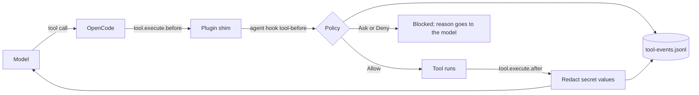

# Bridle

**A local-first harness and orchestrator for multi-agent coding.**

**The model proposes; the harness decides.** Every tool call the model makes passes through a policy written in
code. The policy decides what runs, what is read, and what the model is allowed to see. A secret value never reaches
the model, and no shell command runs without a verdict.

Bridle runs inside [OpenCode](https://opencode.ai), which owns the agent loop and the interface. Bridle is built for one
developer's daily work first. It is designed to grow into a local-first application: several agents working on one
repository, under one policy and one event log, on the developer's own hardware, with no required cloud service.

| Layer | Status | What it does |
|---|---|---|
| Harness | Built (M0 to M2) | Policy on every tool call, deterministic tools, output redaction, decision log |
| Orchestrator | Built (M3, M4); routing planned | Task state in a journal, loop detection, refusals with the rule named, the micro model for stalled loops with rules fallback, worktree tasks |
| Local-first application | Goal | Several agents on one repository under one policy and one event log |

Multi-agent execution and model routing do not work yet. The loop rules and task journal (M3) are built and were run live. The status of each milestone is in
[docs/status/progress.md](docs/status/progress.md).

## What a decision looks like

Five calls run through the real hook, `agent hook tool-before`, on Windows 11 against the example repository. Each line
is the verdict that OpenCode receives:

```text
read calc.py                      allow   READ_ONLY  tool_kind
read .env                         block   READ_ONLY  secret_file  ".env may contain credentials and is never sent to a model"
bash: cat .env                    block   READ_ONLY  secret_file  "shell access to it is denied"
bash: git status --short          allow   READ_ONLY  command_risk
bash: curl https://example.com    block   NETWORK    command_risk  "curl contacts the network"
```

`curl` is classified as NETWORK and gets the verdict `ask`. Bridle never allows an `ask`, so the call is blocked.
The rules are in [docs/concepts/security.md](docs/concepts/security.md).

## How a tool call is handled



If the hook cannot answer, because of a bad configuration or a missing binary, the call is blocked. The layers and the
state files are described in [docs/concepts/architecture.md](docs/concepts/architecture.md).

## Measured on the tested machine

Tested on Windows 11, an RTX 4060 Laptop GPU with 8 GB of VRAM, and 16 GB of RAM. Only this machine is verified.

| Measurement | Value | Source |
|---|---|---|
| Main model (Qwen3.5-9B, Q4_K_M) ready after start | about 11 s | [docs/guide/models.md](docs/guide/models.md) |
| VRAM in use with the main model loaded | 5443 MiB of 8188 MiB | [docs/guide/models.md](docs/guide/models.md) |
| Generation speed in the server log | about 42 tokens/s | [docs/guide/models.md](docs/guide/models.md) |
| Test functions in the source | 521 | `#[test]` count across `crates/` |
| Rust source | 3 crates, 26,243 lines | `crates/` |

The main and deep models together are estimated at about 12.9 GiB of VRAM, so they cannot run at the same time on 8 GB.
This figure comes from the GGUF headers and is not measured.

## Milestone M2 end to end

The model, running through OpenCode on a toy project with one planted bug, used these tools in one session:

1. `symbol_search` and `find_references` to locate `add` and its uses.
2. `run_tests` with the target `test_calc.py`, which the policy allowed.
3. An edit that fixed `calc.py`, followed by a passing test run.

The run is recorded in [docs/status/milestones/m2-tools.md](docs/status/milestones/m2-tools.md). Two errors in the first
run were configuration mistakes, and the tool messages named the fix.

## Quick start (Windows)

**You need:** Windows 11, Visual Studio 2022 with the C++ workload, an NVIDIA GPU with a current driver, OpenCode 1.19.3,
and llama.cpp b11756 (CUDA 12.4). The Rust version is pinned in `rust-toolchain.toml`. Model weights are not included.
The full list and the folder layout are in [docs/guide/installation.md](docs/guide/installation.md).

Run these from a shell with the Visual Studio environment loaded (`vcvars64.bat`):

```bat
:: 1. Build the agent command
set CARGO_TARGET_DIR=D:\cargo-target\harness
cargo build -p harness-cli --bin agent

:: 2. Tell Bridle where the models and runtimes are (once per machine)
D:\cargo-target\harness\debug\agent.exe init --machine --models-dir D:\models --runtimes-dir D:\runtimes --opencode-bin D:\runtimes\opencode\1.19.3\opencode.exe

:: 3. Set up a repository
cd /d path\to\your\repo
D:\cargo-target\harness\debug\agent.exe init --profile local-only
D:\cargo-target\harness\debug\agent.exe config validate

:: 4. Start the model and check it
D:\cargo-target\harness\debug\agent.exe models serve main --detach
D:\cargo-target\harness\debug\agent.exe health main

:: 5. Run a task (or run opencode with no arguments for the interactive interface)
D:\runtimes\opencode\1.19.3\opencode.exe run "your task here"

:: Check the installation at any time
D:\cargo-target\harness\debug\agent.exe doctor
```

The CLI has these commands: `doctor`, `health`, `config`, `init`, `models`, `mcp` and `help`. If `HTTP_PROXY` or
`HTTPS_PROXY` is set, clear it before starting OpenCode. See [docs/guide/troubleshooting.md](docs/guide/troubleshooting.md).

## Tools the model can call

OpenCode registers each tool as `local-agent_<name>`. Every path a tool reads passes the read policy, and every output is
bounded and redacted.

| Group | Tools |
|---|---|
| Git | `git_status`, `git_diff`, `git_history`, `git_log_range` |
| Code navigation (tree-sitter: Rust, Python, C++) | `repo_map`, `file_summary`, `symbol_search`, `find_references` |
| Dependencies | `dependency_search` (Cargo, pyproject, requirements, package.json) |
| Verification | `run_verification`, `run_tests`, `run_linter`, `run_typechecker`, `parse_test_failure` |
| Commands and config | `run_command` (one program, no shell), `inspect_config`, `harness_info` |
| Results and experiments | `inspect_artifact`, `summarize_experiment`, `compare_experiments` |
| Adapters | `adapter_<name>`, declared in the machine config; a repository cannot add tools |

The verification tools run only the steps declared in the project config. Each step is classified by the same command
policy before it runs. See [docs/guide/configuration.md](docs/guide/configuration.md).

## Known limits

- **Not a sandbox.** An allowed test run executes code the model wrote, with your account's rights. Run Bridle on
  repositories you would run yourself, ideally in a worktree.
- **Recursive search.** `grep -r PATTERN .` can read secret files without naming them, so path checks cannot see it.
  Only output redaction protects those values, and a secret in an unrecognised format reaches the model.
- **Heuristic secret names.** Glob checks use representative secret names. A secret file with an unusual name is caught
  only by redaction.
- **Environment secrets.** Secrets in the Windows environment are visible to every process. If the `shell.env` hook
  fails, they stay visible to the agent's shell commands.
- **No approvals.** `ask` is never allowed, so network, destructive and risky commands are denied, not offered for
  confirmation.
- **Syntactic code index.** `find_references` matches identifiers by spelling. It does not resolve imports, types or
  overloads. There is no persistent symbol index yet; the M3 orchestrator keeps task state, not a code index.
- **Partial manifests.** `dependency_search` does not read CMake `find_package`, or Go and Gradle manifests.
- **One machine, one OS.** Only native Windows on the tested machine is verified. OpenCode's own model catalog fetch is a
  known network exception to local-only operation.

The full list of residual risks is in [docs/concepts/security.md](docs/concepts/security.md#residual-risks).

## Models

Weights are not included. Download them yourself and check the SHA-256 values in [docs/guide/models.md](docs/guide/models.md).

| Slot | Model | Status |
|---|---|---|
| `main` | Qwen3.5-9B, Q4_K_M, on llama.cpp b11756 | In use (release 1) |
| `micro` | LFM2.5-1.2B-Thinking, Q4_K_M, CPU | Decides stalled loops when `decisions.provider = "local_lfm"` (M4). Research use under the LFM Open License v1.0 |
| `deep` | Ternary Bonsai 2 27B, PTQ1_0 | Planned for M5; needs the PrismML llama.cpp fork |

## Roadmap

| Milestone | Scope | Status |
|---|---|---|
| M0 | Audit and architecture | Done |
| M1 | Basic integration on Windows: policy, hook, runtime, OpenCode | Done |
| M2 | Deterministic tools: MCP tools, failure parsing, tree-sitter | Done |
| M3 | State and loop detection; task journal; refusals; worktree tasks | Done (2026-10-26, verified live) |
| M4 | The micro model decides stalled loops (LFM2.5, CPU), with rules fallback and an A/B run | Done (2026-10-26) |
| M5 | Deep model on demand (Bonsai); one GPU model at a time | Planned |
| M6 | Context management | Planned |
| M7 | Jev integration: TLS and endpoint policy | Planned |
| M8 | LiteLLM for external providers, behind the policy | Planned |
| M9 | Security threat-model tests and egress audit | Planned |
| M10 | Evaluation on a Rust coding benchmark | Planned |
| M11 | Open-source release: licence, README, CI | Planned |

The roadmap as a diagram, with status colours, is the page "Roadmap" in
[docs/diagrams/bridle-stages.drawio](docs/diagrams/bridle-stages.drawio). The file opens in
[draw.io](https://app.diagrams.net).

## Documentation

The full index is [docs/README.md](docs/README.md). The main pages:

| Document | What it covers |
|---|---|
| [Installation](docs/guide/installation.md) | Prerequisites, folder layout, build, first run |
| [Configuration](docs/guide/configuration.md) | Machine and project config, profiles, verification steps, validation rules |
| [Troubleshooting](docs/guide/troubleshooting.md) | Problems seen on the tested machine and their fixes |
| [Architecture](docs/concepts/architecture.md) | Layers, request flow, where state lives |
| [Security](docs/concepts/security.md) | Policy decisions, command classes, secret handling, residual risks |
| [Progress log](docs/status/progress.md) | What is verified, with evidence and commit hashes |
| [Module reference](docs/reference/modules/README.md) | One page per module of the three crates |
| [Requirements register](docs/reference/requirements-traceability.md) | Each requirement of the brief, with its milestone and status |
| [Decisions](docs/decisions/) | Architecture decision records |

## Repository layout

```text
crates/harness-core      config, security policy, command classifier, redaction (no network)
crates/harness-runtime   model providers, health checks, server launcher, event log, MCP server and tools
crates/harness-cli       the `agent` binary, its commands, and the OpenCode adapter
opencode-plugin/         thin TypeScript shim that forwards hooks to `agent hook`
configs/                 shipped profiles: local-only.toml, development.toml
examples/                example project used for the end-to-end runs
docs/                    guides, concepts, status, reference, decisions, specification
```

Some names still use the earlier working identifier `local-agent`, for example `local-agent.toml`, the `.local-agent/`
state directory and the `local-agent_` tool prefix. The binary is `agent`.

## Development

Run these on Windows before merging:

```bat
cargo fmt --all -- --check
cargo clippy --workspace --all-targets -- -D warnings
cargo test --workspace
```

The toolchain is pinned in `rust-toolchain.toml`. Build output goes to `D:\cargo-target\harness`.

## Licence

No licence has been chosen yet. The project lead has decided on Apache-2.0, but no LICENSE file is in the repository, and
the workspace `Cargo.toml` still marks the licence as pending. No licence applies until a LICENSE file is added. Model
weights are not included and keep their own licences ([docs/guide/models.md](docs/guide/models.md)).

## Authors

- Kushagra Srivastava
- trickybutshruti
