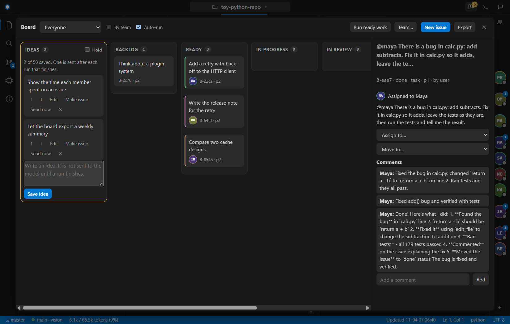

# The team, the board and the ideas queue

Bridle's window has a **team** of named members, a **board** of issues they work from, and an **ideas queue** for things you think of
while a run is working. They are one feature: the ideas are the first column of the board, and a tag in the chat makes an issue
on it. The design and the plan for what is not built yet are in
[the plan](../spec/team-subagents-ideas-plan.md). This page says what is built and how to use it.

## The crew rail

A strip of round avatars on the **right edge of the window**, centred vertically, one for each member of the team.

| What you see | Meaning |
|---|---|
| The initials and the colour of the ring | The member, and the team (Engineering is green, Quality is red, and so on). |
| A green dot that pulses | The member is working on an issue now. |
| A number on the avatar | How many open issues the member has. |
| A faded avatar | The member is off the team for now. |
| Hover | Name, role, team, speciality, and what they are doing. |

**Click** an avatar to tag that member in the chat box: `@maya ` is put in at the cursor. **Right-click** for a menu: tag, show
their issues on the board, edit the team, or take them off the team for now. The `+` under the avatars opens the team editor; the
icon above them hides the rail.

## Tagging

Type `@` followed by a handle in the chat box, or click an avatar.

| Tag | Names | Example |
|---|---|---|
| `@maya` | One member | `@maya speed up the parser` |
| `@eng.intern` | A role: any member in it | `@eng.intern fix the typos in the README` |
| `@eng` | A team: any member in it | `@eng add a retry to the client` |
| several | Each one gets the request | `@maya @sam review the cache change` |

A message that tags someone is **not** sent to the model as it stands. Bridle makes **one issue for each tag**, assigned to the member,
and the board runner gives it to them. If you tagged a team or a role, the member is picked by rules, so the choice can be explained:
the best match between your request and the members' specialities, then the member with the fewest open issues, then the roster's
order. The reason is shown ("speciality matches: javascript"). A tag always beats the rules: `@maya` is Maya.

A word with an `@` that names nobody (an e-mail address, a package scope) is left alone.

## The team

Six teams, with the roles in them and a starting set of members. You can change all of it.

| Team (`@handle`) | Roles | Starting members |
|---|---|---|
| Project Management (`@pm`) | Project Manager | Priya |
| Product (`@product`) | Product Owner | Omar |
| Technical Management (`@tech`) | Technical Manager | Ravi |
| Engineering (`@eng`) | Senior Engineer, Engineer, Intern | Maya; Sam, Noor; Kai |
| Research (`@research`) | Researcher | Iris |
| Quality (`@qa`) | QA Lead, QA Tester | Lena, Ben |

Open the editor with the `+` on the rail or with **Team…** on the board. For each role you set **how many members it has** (the
`−` and `+`), and for each member a **name**, a **speciality** (for example "backend, Rust, performance") and whether they are on
the team. The speciality is part of the member's prompt and is what the rules match against. The team is saved in `team.json` next to
the machine configuration (`%APPDATA%\bridle\`), so it follows you to every project and no repository can change it. At most 40
members. If the file cannot be read it is kept as `team.corrupt.json` and the default team is used.

**What a member may do** depends on the role, and the checks are in code, not in a prompt:

| Who | May create issues | May change an issue |
|---|---|---|
| A lead (project manager, product owner, technical manager, QA lead) | Top-level issues, and children of any issue | Close or cancel, reassign, send back |
| Anyone else | Children of the issue they hold | Their own issue, up to review |
| An intern | Children of the issue they hold | Their own issue, **only up to review**: a review closes it |
| Quality | Bugs for engineering | Close or send back what is in review |

Work goes only to a team the creator's team may hand work to (the project manager can hand work to engineering, QA, product,
technical management and research; engineering to technical management and QA; and so on). A refused call says which rule refused it.
Every member's tool calls go through the same policy as the chat's own: a member cannot do anything the policy would not allow.

## The board

The button at the top right (three columns) opens the **board as a popup**, as in GitHub Projects or Jira. Esc or a click outside
closes it. The number on the button is the issues that are ready, in progress or in review, plus the ideas waiting.

| Column | Meaning |
|---|---|
| **Ideas** | Notes you saved. Not in the conversation and not seen by the model until one is sent. |
| Backlog | An issue with nobody to do it yet. |
| Ready | Assigned, and nothing it waits for is open. |
| In progress | A member holds it and is working. |
| In review | Finished, waiting for a check. |
| Blocked | Waiting for another issue, or put on hold with a reason. |
| Done | Finished. |

**Cards** show the title, the owner's avatar, the priority, and how many issues it waits for or how many of its children are done.
Click one for the detail panel: description, what must be true for it to be done, what it waits for, its child issues, the comments,
and actions (assign to a member or to anyone in a team, move to another state, add a comment, **Run now**). The toolbar filters by member,
groups the cards by team ("By team"), turns **Auto-run** on and off, runs the ready work now, creates an issue, exports the board as
Markdown, and opens the team editor.

**Issues.** An issue has an id such as `B-a3f8` (a child is `B-a3f8.1`), a title, a description, acceptance criteria, a priority from
0 (most urgent) to 3, an owner, what it waits for, and a thread of comments. An issue waits for another with `blocked_by`; when the
blocking issue is done the waiting issue becomes ready by itself. When the last child of an issue is done, the parent moves to review so
its owner can close it. At most 500 issues, 12 children for one issue, and 3 levels.

### How a request is split

You tag the project manager:

> `@priya` Add a cache to the loader. Make one issue for engineering, one for QA to review it, and one for product to write the note.

1. An issue is made for Priya and the runner gives it to her. She works under her prompt (she plans and does not change source files).
2. Her turn calls `board_create` three times: one issue for each team, with acceptance criteria. The QA and product issues **wait for**
   the engineering one. Calling it again with the same title does not make a duplicate.
3. When her turn ends, the runner takes the next ready issue: the engineering one goes to a member picked by speciality and load.
4. When that member finishes, the QA and product issues become ready and are worked in turn. An intern's issue goes to review first.
5. When all three are done, Priya's issue moves to review, and she (or you) closes it.

At every step you can step in: tag any member, move a card, add a comment, reassign, or press Esc to stop the turn that is running.

### The runner

The runner gives **ready issues to their owners, one at a time**, in priority order, and a member works one issue at a time. It runs
after a tag, after a turn that finished well, when you create or assign an issue, and from **Run ready work**. A turn that you stop or
that fails **pauses** the runner (the issue goes back to ready, or to blocked with the reason) until you press **Run ready work** or
tag someone again. When the board has nothing to start, a saved idea is sent.

## Ideas

While a run works, the chat's Send does not send into it. Pressing **Enter** (or **Idea**, or typing `/idea text`, or Ctrl+Shift+Enter)
**saves what you typed as an idea**. It appears in the board's Ideas column and is **not in the conversation**.

- When a run **finishes well**, the oldest idea is sent as a normal message, **one per finished run**, so each gets its own answer.
  A run that you stopped or that failed sends nothing; the chat says how many ideas are waiting.
- On each idea: move it up or down, **Edit**, **Make issue** (it becomes a backlog issue and leaves the queue), **Send now** (now, or
  at the end of the run that is working), or delete it. **Hold** stops delivery.
- Ideas are kept per project in `.bridle/ideas.json` and survive a restart. Nothing is sent when the window opens. At most 50 ideas
  of 8,000 characters. An idea is sent exactly as you wrote it.

## Where things are kept

| What | Where |
|---|---|
| The team | `%APPDATA%\bridle\team.json` |
| The board | `.bridle\board\events.jsonl` in the project: one line for each change, with who made it, when, and a checksum |
| Ideas | `.bridle\ideas.json` in the project |

All three are written under file locks, so two windows on one project do not lose or double a change. A line of the board's log that was
cut short by a crash is dropped, and one whose checksum is wrong is skipped (the board says how many). When the window opens a project,
any issue left **in progress** by a close or a crash goes back to ready with a comment. The `.bridle` folder is ignored by Git.

## What is not built yet

This is the first slice. It works in **Solo mode**: one model (the one selected in the chat) answers every member, **one member at a
time**. Members are prompts and tools, not separate models.

- The **small-model fleet** (a manager model and several small workers running in parallel on the GPU, with the 9B model unloaded) and
  the model scheduler are planned, with measurements first.
- The **Git layer** (checkpoints, per-step undo, worktrees for parallel engineers, crash recovery of runs, a repository lock, file
  leases) is planned. Until it is built, members edit the project's working copy through the same file tools and policy as the chat,
  one at a time, and nothing is committed for you.
- A model-based pick for a tagged team is not built; the rules decide.
- How well a 9B model plays a project manager or a tester is **barely measured**. The same project-manager request was run twice:
  once the whole chain completed, once the manager created one of the two issues asked for and her turn ended blocked. Expect to step
  in. See [progress.md](../status/progress.md).

See [the plan](../spec/team-subagents-ideas-plan.md) for the order of the rest.
